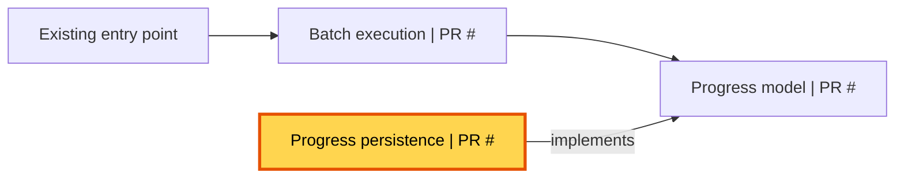

# Stacked PR description

Use this template for every PR. Replace all placeholders with verified information.
Use short sentences and concrete review guidance.

## Content rules

- Link the Jira ticket in the first heading.
- Explain what this PR changes and why. Distinguish current behavior from behavior added by later PRs.
- List every PR in merge order with links, short purposes, and the current PR marker.
- Explain that each PR targets the preceding branch, except the first PR.
- Show the complete feature or bugfix in a Mermaid overview, not only the current PR changes.
- Label component ownership with PR numbers. Distinguish unchanged components from stack changes.
- Keep node IDs, labels, and edges consistent across all PR overviews.
- Highlight all current PR components with `thisPr`. Do not highlight components owned only by another PR.
- Add a text legend and a current-component list so readers do not depend on color alone.
- Prefer `flowchart LR`. Use another layout when it makes the diagram easier to read.
- Add a sequence, state, or flow diagram only when it explains behavior that the overview does not show.
- Make review focus specific to the current diff: invariants, failure paths, compatibility, security, or rollout risks.
- Include actual test commands and results. Label checks that did not run.
- Put detailed context in the final expandable section for reviewers and agents.
- Record verified decisions, constraints, code paths, rejected alternatives, and operational details there when relevant.
- Omit empty bullets and optional sections. Do not invent decisions, test results, or rollout guarantees.
- Use simple words, no jargon and be concise. We don't like wall of texts.

## Template

````markdown
## [FOOBAR-123](<jira-url>)

**Summary:** <What this PR changes and why. State what remains inactive until later PRs, if applicable.>

### Stack

Merge in this order. Each PR after the first uses the preceding PR branch as its base.

1. #<number> - <Purpose>
2. **#<number> - <Purpose> (👈 this PR)**
3. #<number> - <Purpose>

## Overview

Yellow nodes belong to this PR. Current components: <component names>.
Unchanged components have no PR number.



## Additional diagram

<Optional Mermaid diagram for current PR behavior. Remove this section when the overview is sufficient.>

## Review focus

- <Specific invariant, failure path, or design decision to check in this PR.>
- <Dependency, compatibility constraint, or rollout condition that affects review.>
- <Trade-offs and rejected alternatives>

<details>
<summary>Technical context for reviewers and agents</summary>

<Include only useful context: affected components and interactions, design decisions, trade-offs, rejected alternatives, edge cases, and relevant file paths or links. Do not repeat the diff.>

</details>
````
